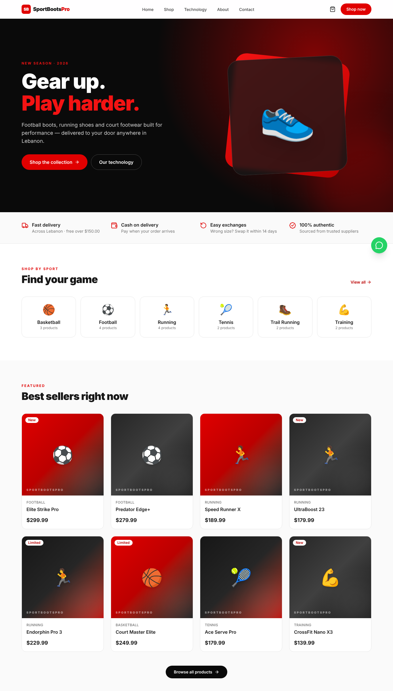
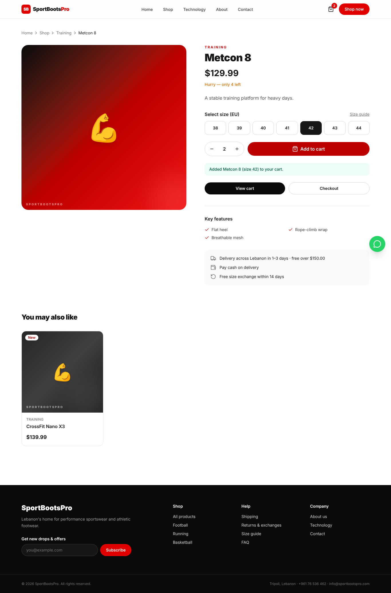
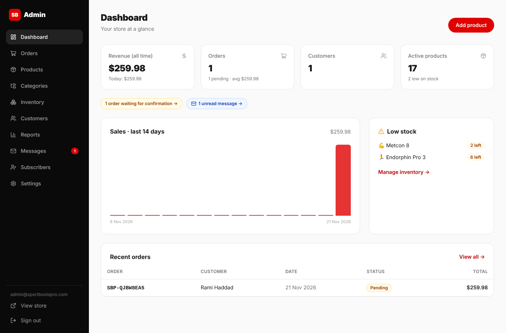
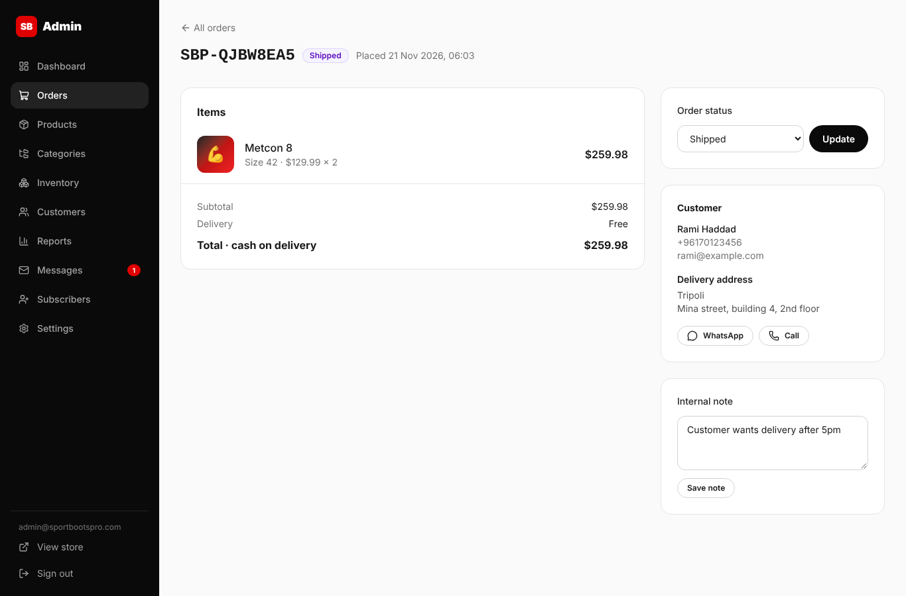
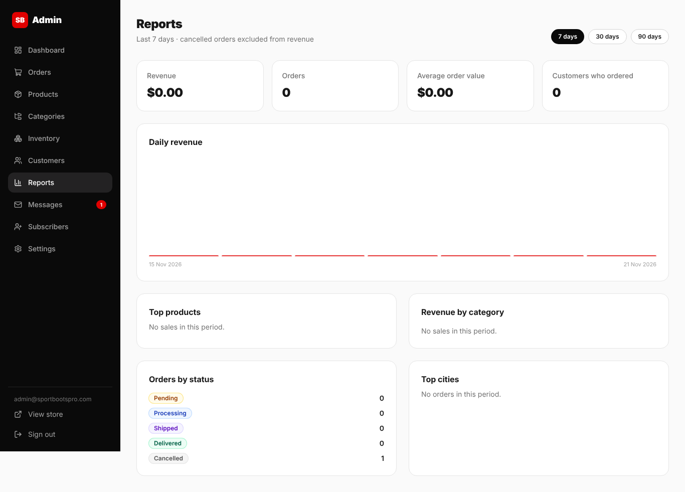

# SportBootsPro

A sportswear and athletic-footwear store for Lebanon: a storefront where customers shop and order with cash on delivery, and an admin dashboard where the shop owner manages products, stock, orders and customers.

**Stack:** Next.js 16 (App Router, Server Actions) · TypeScript · Tailwind CSS 4 · PostgreSQL + Drizzle ORM · Zod · Vitest · GitHub Actions



## Features

### Storefront
- Home page with categories, featured products, newsletter sign-up and a WhatsApp button
- Shop with search, filter by sport and price, sorting and pagination (shareable URLs, works without JavaScript)
- Product pages with EU size picker, live stock, sale prices, related products and Google-friendly structured data
- Cart stored in a secure cookie. Prices and stock always come from the database, never from the browser.
- Checkout with cash on delivery, field-level validation and free-delivery threshold
- Order confirmation page with a one-tap WhatsApp message
- Contact form (with spam honeypot and rate limit), FAQ, shipping, returns, size guide, about and technology pages
- Sitemap, robots.txt, Open Graph metadata, mobile-first responsive design, keyboard and screen-reader friendly

### Admin dashboard (`/admin`)
- Secure login (bcrypt passwords, signed httpOnly session cookie, brute-force rate limit)
- Dashboard: revenue, orders, customers, 14-day sales chart, low-stock alerts, recent orders
- Orders: filter by status, search, order details, status updates, internal notes, WhatsApp/call the customer
- **Cancelling an order puts its items back in stock automatically**
- Products: create, edit, hide or delete, with sizes, sale price, badge, image URL and featured flag
- Categories, bulk inventory editing, customers with order history and lifetime spend
- Reports for 7/30/90 days: revenue, average order, top products, revenue by category, orders by status, top cities
- Contact-form inbox, newsletter subscribers with CSV export, store settings and password change

### Built to be correct
- **No overselling:** checkout locks product rows in a database transaction and re-checks size, price and stock before creating the order
- Money stored as integer cents (no rounding errors)
- Every admin page **and** every admin action checks the session, not only the route guard
- Input validated with Zod on the server, and image URLs restricted to `http(s)`
- Security headers, CSV-injection-safe export, constant-time login failure

| | |
|---|---|
|  |  |
|  |  |

## Run it locally

You need **Node.js 20.9+**. No database setup is needed for development.

```bash
npm install
npm run dev
```

Open http://localhost:3000. On first run the app creates a local PostgreSQL database (PGlite, stored in `.data/`), runs the migrations and adds demo products.

**Admin:** http://localhost:3000/admin with `admin@sportbootspro.com` / `admin12345` (local only; set your own for production).

To start over with fresh demo data, stop the server and delete the `.data` folder.

## Scripts

| Command | What it does |
|---|---|
| `npm run dev` | Development server |
| `npm run build` / `npm start` | Production build / server |
| `npm test` | Unit + database tests (25 tests, in-memory PostgreSQL) |
| `npm run lint` / `npm run typecheck` | ESLint / TypeScript |
| `npm run db:generate` | Create a migration after editing `src/db/schema.ts` |
| `npm run db:migrate` | Apply migrations to `DATABASE_URL` |
| `npm run db:seed` | Add demo catalog, settings and your admin (`ADMIN_EMAIL`, `ADMIN_PASSWORD`) |

## Deploy (free): Vercel + Neon

1. **Database:** create a free PostgreSQL database on [Neon](https://neon.tech) and copy its connection string.
2. **Create the tables and your admin** from your computer:
   ```bash
   export DATABASE_URL="postgres://…neon.tech/neondb?sslmode=require"
   npm run db:migrate
   ADMIN_EMAIL="you@example.com" ADMIN_PASSWORD="a-long-strong-password" npm run db:seed
   ```
3. **App:** import this repo on [Vercel](https://vercel.com) and add these environment variables:
   - `DATABASE_URL`: the Neon connection string
   - `AUTH_SECRET`: output of `openssl rand -hex 32`
   - `NEXT_PUBLIC_SITE_URL`: your site address, e.g. `https://sportbootspro.vercel.app`
4. Deploy. Check `https://your-site/api/health`, which should say `{"ok":true,"db":"up"}`.

Any Node.js host works the same way (Railway, Render, a VPS with `npm run build && npm start`). Plain PHP shared hosting such as InfinityFree cannot run this app.

## Project structure

```
src/
  app/
    (shop)/          storefront pages (home, shop, product, cart, checkout, info pages)
    admin/           admin login + dashboard pages
    actions/         server actions (cart, checkout, forms, admin mutations)
    api/health/      health check
  components/        UI components (shop/, admin/)
  db/                Drizzle schema, connection, migrations runner, seed data
  lib/               business logic: orders, cart, catalog & admin queries, auth, validation
  proxy.ts           redirects signed-out visitors away from /admin
drizzle/             SQL migrations
tests/               Vitest tests
```

## License

All rights reserved © SportBootsPro.
